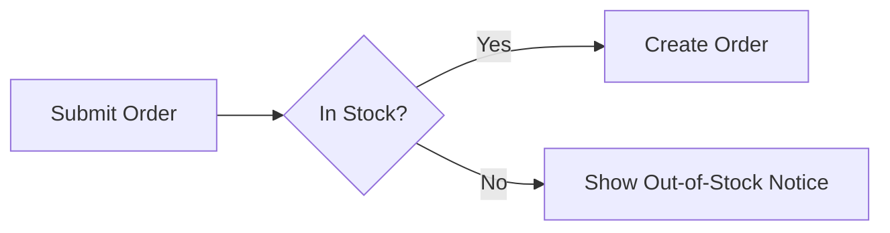


Dieser Beitrag wurde von einer KI ins Deutsche übersetzt. Der englische Originalinhalt wurde von mir verfasst. [Zum englischen Original](https://rootknecht.net/blog/markdown-writing-app-comparison/)


Vor Kurzem habe ich ein [YT-Video](https://www.youtube.com/watch?v=9Zl6KHzinmM) über iA Writer von [Mostly Mac](https://www.youtube.com/@mostly_mac) gesehen. Ich hatte keine großen Erwartungen, weil ich vorher nie über eine spezialisierte Schreib-App nachgedacht hatte, und habe es mir nur angesehen, weil ich seinen Stil mag.

Seit vielen Jahren schreibe ich meine Blogbeiträge einfach mit meinem stark [angepassten](https://github.com/Allaman/nvim) Neovim und lasse `hugo server`[^1] im Hintergrund laufen, um den Beitrag im Browser zu prüfen.

Dieses Video hat mich jedoch dazu gebracht, über den Tellerrand zu schauen und eine dedizierte Schreib-App in Betracht zu ziehen — ohne den Drang, meine Neovim-Konfiguration noch ein weiteres Mal neu zu schreiben :wink:

Der Fokus liegt auf dem Schreiben von Artikeln für meinen Blog. Das ist das Einzige, was ich derzeit schreibe. Für READMEs bzw. Software-Dokumentation bevorzuge ich Neovim, weil ich dort näher am Code bin. Ich schreibe weder Romane noch wissenschaftliche Arbeiten.

Schauen wir uns zuerst die Funktionen an, die ich meiner Meinung nach von einer dedizierten Schreib-App brauche.

## Anforderungen an meine Schreib-App

In keiner bestimmten Reihenfolge meine Anforderungen an meine Schreibsoftware:

- Die App sollte offline-first sein — keine Cloud, kein „Always on".
- Ich bin langjähriger [Obsidian](https://obsidian.md/)- und [hledger](https://hledger.org/index.html)[^2]-Nutzer und überzeugt, dass Klartext das überlegene Dateiformat ist. Daher muss meine Schreib-App mit Markdown[^3]-Dateien arbeiten.
- Sie sollte für macOS und Linux verfügbar sein. iOS und Android wären ein netter Bonus, aber nicht notwendig.
- Es sollte eine Integration für Rechtschreib- und Grammatikprüfung geben. Wenn diese Integration KI-basiert ist, sollten lokale Modelle unterstützt werden. Wenn [LanguageTool](https://languagetool.org/) unterstützt wird, sollte es eine Einstellung für eine selbst gehostete Instanz geben. Eine [Harper](https://writewithharper.com/)-Integration wäre ebenfalls großartig.
- Fokus- und Schreibmaschinenmodus, um sich zu fokussieren. :wink:
- Für meine Arbeit ist das nicht so wichtig, aber beim Schreiben von Artikeln schätze ich eine gute Live-Vorschau.
- Eine ablenkungsfreie, minimale Oberfläche, die nicht im Weg ist.
- Fußnoten-Unterstützung ist essenziell. Ich mag Fußnoten, und Hugo unterstützt die `[^1]`-Syntax zum Erstellen von Fußnoten.
- Unterstützung für typografische Anführungszeichen, Gedankenstriche und Auslassungspunkte, um meinem Text ein professionelleres Aussehen zu geben. :laughing:
- Ich brauche Bildverwaltung und eine einfache Dateiverwaltung, weil ein Blogbeitrag oft Bilder enthält, die ich verwalten und in der Vorschau sehen muss.
- Ich mag auch Tabellen, daher ist eine gute Tabellenunterstützung essenziell für meinen Schreibfluss.
- Für einfache Diagramme nutze ich gerne [Mermaid](https://mermaid.ai/), daher ist das Rendern davon zusätzlich zu LaTeX-Mathesymbolen ein Gewinn.
- Um bestimmte Aussagen hervorzuheben, sollte die App [GitHub-Alerts](https://docs.github.com/en/get-started/writing-on-github/getting-started-with-writing-and-formatting-on-github/basic-writing-and-formatting-syntax#alerts) unterstützen.
- Kein Abonnement. Wir alle haben so viele Abonnements, dass ich hier eine Grenze ziehen möchte.

## Kandidaten

Bei meiner Recherche bin ich auf folgende Anwendungen für Schreibende gestoßen.

- [iA Writer](https://ia.net/writer) (8.0.9)
- [Typora](https://typora.io/) (1.14.10)
- [Calmly Writer](https://www.calmlywriter.com/) (3.0.7)
- [MarkText](https://marktext.me/) (0.21.1)
- [Scrivener](https://scrivener.software/)
- [Ulysses](https://ulysses.app/)
- [Neo](https://hughhowey.com/neo/)
- [Obsidian](https://obsidian.md/)

Es gibt viele weitere Anwendungen, die Markdown unterstützen, wie klassische Editoren oder IDEs[^4], aber mein Fokus liegt auf Apps, die auf das Schreiben spezialisiert sind.

Von vornherein würde ich **Neo**, **Scrivener** und **Ulysses** aussortieren. Meiner Meinung nach liegt ihr Fokus viel stärker auf großen Projekten wie Romanen. Lasst mich wissen, falls mein erster Eindruck falsch war!

## Vergleich

Ich habe eine Testdatei erstellt, um die verschiedenen Apps und ihre Darstellung wichtiger Markdown-Syntax zu veranschaulichen.



````markdown
# Heading 1

Of course, all the usual formatting is supported: _italics_, **bold**, <u>underline</u>, ~~strike~~, 2^8^, H~2~O [rootknecht.net](https://rootknecht.net)

## Heading 2

| One | Two |
| --- | --- |
| Foo | Bar |

### Heading 3

We all like footnotes[^1]

#### Heading 4

> [!IMPORTANT]
> This is very important

##### Heading 5



###### Heading 6

Writing $\LaTeX$ is awesome $f = \frac{2 \pi}{T}$.

[^1]: Don’t we?
````



### Obsidian

Ich bin ein großer Fan von Obsidian und nutze es für mein [PKM](https://de.wikipedia.org/wiki/Pers%C3%B6nliches_Wissensmanagement). Obwohl sich Obsidian nicht in erster Linie an Schreibende richtet, ist es dank seiner Vielzahl an Plugins hochgradig anpassbar.[^5] Ich bin sicher, dass man es so einrichten kann, dass es wie die anderen hier genannten Apps funktioniert, aber ich möchte nicht daran herumbasteln und in ein weiteres Kaninchenloch abtauchen :smile:

Einige Plugins, die einen Blick wert sind: [obsidian-seo](https://github.com/davidvkimball/obsidian-seo), [keep-the-rhythm](https://github.com/benjaminezequiel/keep-the-rhythm), [obsidian-typewriter-mode](https://github.com/davisriedel/obsidian-typewriter-mode), [obsidian-readin-time](https://github.com/avr/obsidian-reading-time), [harper-obsidian-plugin](https://github.com/automattic/harper-obsidian-plugin), [longform](https://github.com/kevboh/longform) und schließlich [word-smith](https://github.com/Sadsnake1/word-smith), ein Plugin, das alles vereint. Das letzte Plugin hat mich neugierig gemacht und ich habe es kurz ausprobiert. Ehrlich gesagt hat es für mich dasselbe Problem wie Obsidian (natürlich, es ist ja ein Obsidian-Plugin :laughing:): zu viele Optionen und zu überwältigend.

Dennoch hat Obsidian weiterhin seinen Platz in meinem Blog-Workflow. Dazu später mehr.

### Calmly Writer Pro

[Calmly Writer](https://www.calmlywriter.com/) ist für Windows, macOS und Linux verfügbar und kostet einmalig 23,90 €. Es gibt eine 14-tägige uneingeschränkte kostenlose Testversion.

Die App hat mich mit einem durchdachten Einstellungsmenü überrascht, mit Extras wie Soundeinstellungen, die eine mechanische Schreibmaschine nachahmen, und einer sehr aufgeräumten Oberfläche. Leider unterstützt sie keine Fußnoten, keine Mermaid-Diagramme und keine $\LaTeX$-Mathematik.

Da diese Funktionen für meinen Workflow entscheidend sind, habe ich mich nicht tiefer mit der App beschäftigt. Wer diese nicht braucht, dem kann ich Calmly Writer sehr empfehlen.


### iA Writer

[iA Writer](https://ia.net/writer) ist als Einmalkauf für Windows (34,99 €), macOS (44,99 €) und iPad/iPhone (19,99 €) erhältlich. Man muss für jede Plattform separat bezahlen. Die Desktop-App bietet eine 7-tägige uneingeschränkte Testversion. Von den Apps, die ich mir genauer angesehen habe, ist sie die einzige, die auch mobil verfügbar ist (allerdings nicht für Android).

Im [YT-Video](https://www.youtube.com/watch?v=9Zl6KHzinmM) wurde iA Writer hoch gelobt, und das war der Grund, warum ich mich überhaupt näher mit diesem Thema beschäftigt habe. Meine Erwartungen waren hoch, besonders angesichts ihres Slogans

> The Benchmark of Markdown Writing Apps

Nach dem Start der App wurde ich von einem E-Mail-Formular begrüßt, das ich nicht überspringen konnte. Das ist die einzige App, bei der man eine E-Mail-Adresse eingeben muss, damit sie funktioniert.

Nach diesem Schock folgte sofort der zweite: Das ist die einzige App, die keine Live-Vorschau unterstützt. Man kann entweder rohes Markdown bearbeiten und eine geteilte Vorschau anzeigen oder nur die Vorschau anzeigen.

Werfen wir einen Blick auf mein Testdokument:


Im Allgemeinen gefällt mir die Vorschau, besonders die zentrierten Überschriften. Das ist etwas, das andere Apps nicht machen. Leider werden GitHub-Alerts und Mermaid-Diagramme nicht unterstützt.

Einige erwähnenswerte Funktionen:

- Suchen & Ersetzen
- Inhaltsverzeichnis
- Ein guter Dateimanager
- Eine Befehlspalette ähnlich der von Sublime Text und VSC
- Fokus- und Schreibmaschinenmodus

Die (nicht konfigurierbare) Schriftart ist sehr angenehm zu lesen, aber kein Alleinstellungsmerkmal von iA Writer, da sie zum [Download](https://github.com/iaolo/iA-Fonts) verfügbar ist.

Am schlimmsten finde ich die schlechte Tabellenbearbeitung und Bildunterstützung. Erstens müssen Tabellen bei der Eingabe streng formatiert sein. Zum Beispiel wird `|h1|h2|` nicht erkannt. Es muss `| h1 | h2 |` sein. Zweitens wird das Wechseln zwischen Zellen nicht unterstützt. Normalerweise befindet sich der Editor in einer Markdown-Tabelle in einem speziellen Modus, in dem man mit _Tab_ zur nächsten Zelle und mit _Enter_ eine Zelle nach unten springt. Drittens werden Bilder, die man per Drag-and-drop einfügt, nicht in den Arbeitsbereich importiert. Man muss sie manuell an den richtigen Ort verschieben, meist neben die Markdown-Datei, bevor man das Bild im Markdown referenziert.

Was wirklich heraussticht, sind die Funktionen „Authorship" und „Editing Tools". Erstere markiert hineinkopierte Textpassagen farbig. So kann man leicht Inhalte nachverfolgen, die man nicht selbst geschrieben hat. Die „Editing Tools" bieten eine Stilprüfung, die Klischees, Füllwörter und überflüssige Formulierungen markiert.

### Typora

[Typora](https://typora.io/) ist für Windows, macOS und Linux verfügbar und kostet einmalig 16,47 €. Es gibt eine 15-tägige uneingeschränkte kostenlose Testversion.

Typora hat eine Live-Vorschau, man kann aber auch in den Quellcode-Modus wechseln.

Werfen wir einen Blick auf die Testdatei


Wow! Alles, was ich möchte, wird korrekt dargestellt, einschließlich GitHub-Alerts und Mermaid-Diagrammen! Es gibt noch viel mehr, was mir an Typora gefällt:

- Hervorragende Tabellenbearbeitung. Mit _Tab_ und _Enter_ bewegt man sich zwischen den Zellen, und die Tabellensyntax wird wie erwartet erkannt.
- Der Bildimport ist sehr komfortabel. Ich kann einfach eine Datei aus meinem Download-Ordner auswählen, und sie wird automatisch neben meine Markdown-Datei kopiert.
- Es gibt eine integrierte Versionierung und Wiederherstellung, mit der man zwischen verschiedenen Versionen seines Dokuments wechseln kann.

Typora bringt einige helle und dunkle Themes mit, man kann aber weitere von ihrer [Webseite](https://theme.typora.io/) herunterladen oder [eigene](https://theme.typora.io/doc/Write-Custom-Theme/) schreiben. Apropos eigene Themes: „Power-User" können Typora per [CSS](https://support.typora.io/Add-Custom-CSS/) anpassen. Zum Beispiel habe ich auf diese Weise die iA-Writer-Schriftart eingestellt.

Typora hat die üblichen Bearbeitungswerkzeuge wie Suchen & Ersetzen, Fokus-/Schreibmaschinenmodus, Inhaltsverzeichnis sowie eine einfache Dateiverwaltung und einen Gliederungsbereich.

Typora hat eine einfache Rechtschreib- und Grammatikprüfung, die aber bei Weitem nicht an die „Editing Tools" von iA Writer heranreicht.

### MarkText

[MarkText](https://marktext.me/) ist für Windows, macOS und Linux verfügbar, Open Source und kostenlos. Allein das ist ein großes Plus für MarkText.

Mal sehen, wie es mit der Testdatei umgeht:


MarkText stellt die Testdatei hervorragend dar. Alles in allem hat MarkText ähnliche Funktionen wie Typora und ergänzt die Liste um eine Befehlspalette und „Block-Handling". Die Tab-Behandlung ist zudem intuitiver und fühlt sich eher wie ein klassischer Texteditor an. Die Exportoptionen sind etwas eingeschränkt, aber man kann immer auf [Pandoc](https://pandoc.org/) zurückgreifen, um Markdown in buchstäblich alles umzuwandeln. Es ist eine solide Wahl, fühlt sich meiner Meinung nach aber etwas unausgereift an.

## Meine Wahl

TLDR: Typora :slightly_smiling_face:

Fassen wir zusammen, was ich anfangs über die Funktionen gesagt habe, die ich von einer Schreib-App erwarte, um diese Aussage zu begründen:

> Die App sollte offline-first sein — keine Cloud, kein „Always on".

Typora hat keine Cloud-Funktionen :white_check_mark: . Ich bin selbst für meine Backups und eine geräteübergreifende Synchronisation verantwortlich.

> Ich bin langjähriger [Obsidian](https://obsidian.md/)- und [hledger](https://hledger.org/index.html)[^2]-Nutzer und überzeugt, dass Klartext das überlegene Dateiformat ist. Daher muss meine Schreib-App mit Markdown[^3]-Dateien arbeiten.

Ja :white_check_mark:

> Sie sollte für macOS und Linux verfügbar sein. iOS und Android wären ein netter Bonus, aber nicht notwendig.

Typora ist für alle drei großen Betriebssysteme verfügbar :white_check_mark: . Es gibt keine Mobile-App :negative_squared_cross_mark:, aber ich habe einen Workaround.

> Es sollte eine Integration für Rechtschreib- und Grammatikprüfung geben. Wenn diese Integration KI-basiert ist, sollten lokale Modelle unterstützt werden. Wenn [LanguageTool](https://languagetool.org/) unterstützt wird, sollte es eine Einstellung für eine selbst gehostete Instanz geben. Eine [Harper](https://writewithharper.com/)-Integration wäre ebenfalls großartig.

Typora hat einige grundlegende Rechtschreib- und Grammatikfunktionen, die aber nicht so leistungsfähig sind wie bei iA Writer, und keine Integration mit einem der beiden Tools. :negative_squared_cross_mark:

> Fokus- und Schreibmaschinenmodus, um sich zu fokussieren. :wink:

Ja :white_check_mark:

> Für meine Arbeit ist das nicht so wichtig, aber beim Schreiben von Artikeln schätze ich eine gute Live-Vorschau.

Ja :white_check_mark: Meiner Meinung nach eine der besten Live-Vorschauen.

> Eine ablenkungsfreie, minimale Oberfläche, die nicht im Weg ist.

Ja :white_check_mark: Man kann alle UI-Elemente ausblenden und sich nur auf den Text konzentrieren.

> Fußnoten-Unterstützung ist essenziell. Ich mag Fußnoten, und Hugo unterstützt die `[^1]`-Syntax zum Erstellen von Fußnoten.

Ja :white_check_mark:

> Unterstützung für typografische Anführungszeichen, Gedankenstriche und Auslassungspunkte, um meinem Text ein professionelleres Aussehen zu geben. :laughing:

Ja :white_check_mark: Kann während des Tippens (meine bevorzugte Variante) oder in der Vorschau umgewandelt werden.

> Ich brauche Bildverwaltung und eine einfache Dateiverwaltung, weil ein Blogbeitrag oft Bilder enthält, die ich verwalten und in der Vorschau sehen muss.

Meiner Meinung nach hat Typora die beste Bildverwaltung, besonders der Bildimport ist sehr komfortabel und ein echter Gamechanger[^6] im Vergleich zu meinem Neovim-Workflow. :white_check_mark:

> Ich mag auch Tabellen, daher ist eine gute Tabellenunterstützung essenziell für meinen Schreibfluss.

Typora hat eine hervorragende Tabellenbearbeitung, die sich fast wie eine Tabellenkalkulation anfühlt. :white_check_mark:

> Für einfache Diagramme nutze ich gerne [Mermaid](https://mermaid.ai/), daher ist das Rendern davon zusätzlich zu LaTeX-Mathesymbolen ein Gewinn.

Ja, beides. :white_check_mark:

> Um bestimmte Aussagen hervorzuheben, sollte die App [GitHub-Alerts](https://docs.github.com/en/get-started/writing-on-github/getting-started-with-writing-and-formatting-on-github/basic-writing-and-formatting-syntax#alerts) unterstützen.

> [!TIP]
> Ja :white_check_mark:

> Kein Abonnement. Wir alle haben so viele Abonnements, dass ich hier eine Grenze ziehen möchte.

Eine Einmalzahlung zu einem vernünftigen Preis, gültig für bis zu drei Geräte. :white_check_mark: Was will man mehr?

Für mich ist Typora derzeit die beste Schreib-App. Sie hat alle Funktionen, die ich brauche, einen vernünftigen Preis, keine Cloud und keinen KI-Bullshit. Wer die volle Kontrolle über sein Schreiberlebnis haben und in das Kaninchenloch der Obsidian-Plugins abtauchen möchte, für den ist Obsidian eine interessante Wahl. iA Writer ist die Wahl für die „Editing Tools", die meiner Meinung nach sein einziges Alleinstellungsmerkmal sind. Wer ein knappes Budget hat oder OSS-Software bevorzugt, sollte sich MarkText ansehen.[^7]

## Nochmal Obsidian

Ich habe erwähnt, dass Obsidian für meinen Workflow weiterhin relevant ist. Wenn man so will, hat Typora einen großen Makel: Es fehlen ein mobiler Client und eine geräteübergreifende Synchronisation. Ich schreibe meine Artikel zum Beispiel gerne auf verschiedenen Geräten. Ich könnte [Syncthing](https://syncthing.net/)[^8] nutzen, um zwischen meinen Geräten zu synchronisieren, aber unter iOS artet das in Bastelei aus, wenn es überhaupt funktioniert. Also hatte ich eine 200-IQ-Idee! :smile: Obsidian ist auf all meinen Rechnern immer geöffnet und hat eine fantastische Mobile-App. Indem ich meinen Artikelordner in meinen Obsidian-Vault lege, werden alle Dateien automatisch per [Obsidian Sync](https://obsidian.md/sync)[^9] synchronisiert (die Dateien müssen nicht mit Obsidian bearbeitet werden, um synchronisiert zu werden). Voilà — meine Dateien sind synchronisiert und gesichert, und ich kann sie auf meinem Smartphone ansehen und bearbeiten.

[^1]: Diese Seite wird mit [Hugo](https://gohugo.io/) erstellt.

[^2]: Meine Buchhaltung erkläre ich in einem anderen [Blogbeitrag](https://rootknecht.net/blog/accounting/).

[^3]: Meiner Meinung nach bietet Markdown den idealen Kompromiss: genug Möglichkeiten ohne die Komplexität eines Satzsystems wie [typst](https://typst.app/) oder gar [LaTeX](https://www.latex-project.org/).

[^4]: [VSC](https://code.visualstudio.com/), [Zed](https://zed.dev/), [Sublime Text](https://www.sublimetext.com/), [JetBrains](https://www.jetbrains.com/) und viele mehr.

[^5]: Dasselbe lässt sich vermutlich über [Joplin](https://joplinapp.org/) sagen, aber ich habe es nie benutzt.

[^6]: Wer auf YouTube unterwegs ist, hasst diesen Begriff vielleicht genauso sehr wie ich, aber ich konnte nicht widerstehen. :laughing:

[^7]: Das werde ich tun. Es wird aktiv weiterentwickelt, und während ich diesen Artikel geschrieben habe, sind bereits zwei neue Versionen erschienen!

[^8]: Die beste Synchronisationssoftware überhaupt. Punkt. Ich nutze sie seit vielen Jahren und sie ist buchstäblich perfekt!

[^9]: Obsidian Sync ist jeden Cent wert. Klar, es gibt kostenlose Alternativen, aber Obsidian Sync funktioniert einfach, und zusätzlich unterstütze ich damit die Entwickler.
