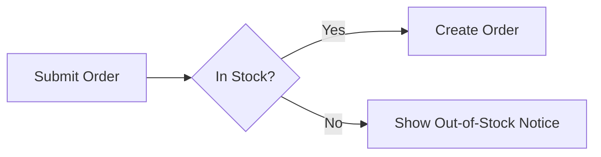
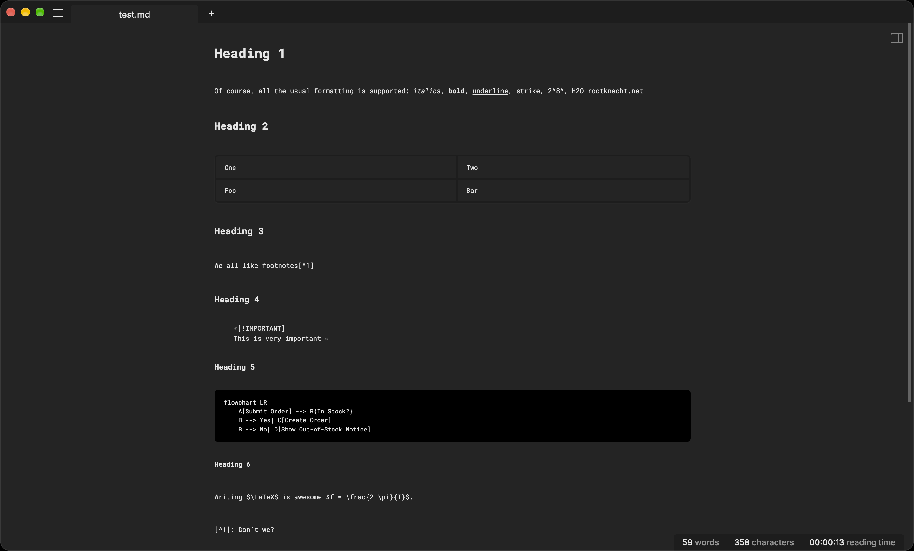
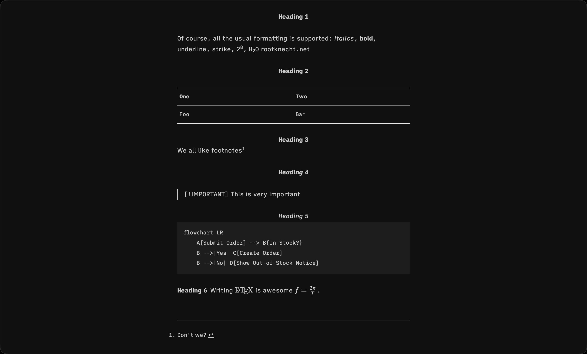
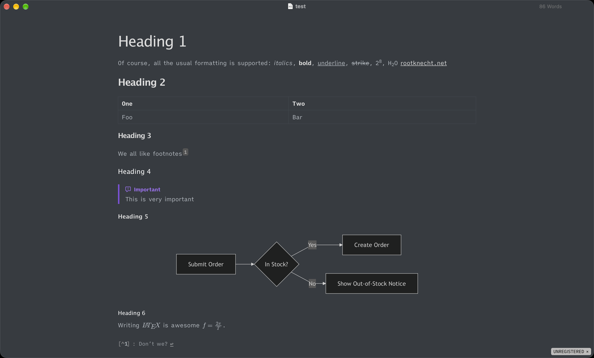
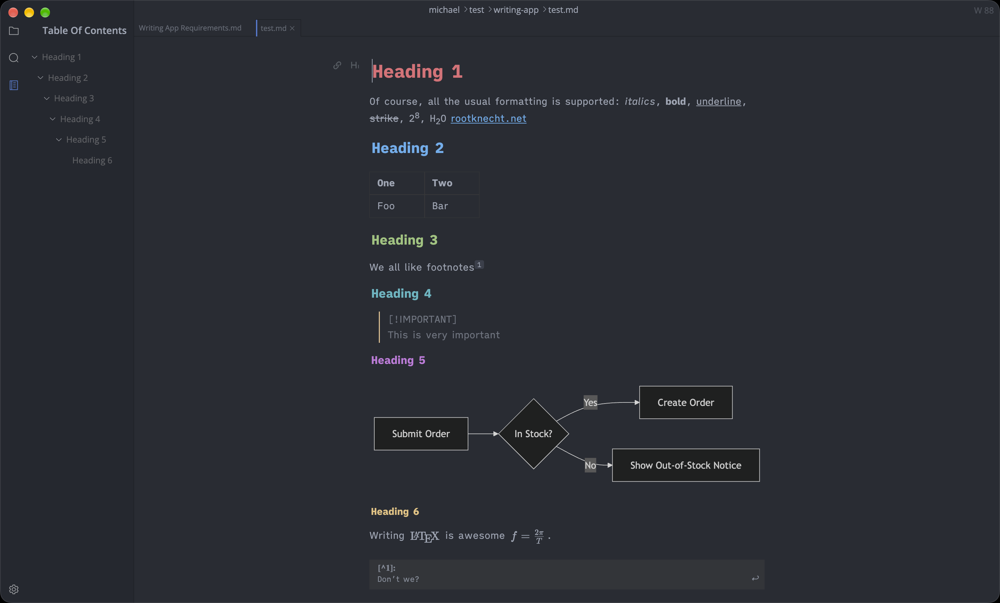

Recently, I watched a [YT video](https://www.youtube.com/watch?v=9Zl6KHzinmM) about iA Writer from [Mostly Mac](https://www.youtube.com/@mostly_mac). I had not many expectations because I did not think about a specialized writing app before and just watched him because I like his style.

For many years, I have been writing my blogposts just with my heavy [customised](https://github.com/Allaman/nvim) Neovim and running `hugo server`[^1] in the background to check the blog post in the browser.

However, this video made me think out of the box and consider a dedicated writer app without the urge to rewrite my Neovim configuration just one more time :wink:

The scope is on writing articles for my blog. This is the only writing I currently do. For READMEs resp. software documentation, I prefer Neovim because I am closer to the code. I don’t write novels or scientific papers.

At first, let’s look at the features that I think I would need from a dedicated writer’s application.

## Requirements for My Writing App

In no particular order my requirements for my writing software:

- The app should be offline first — no cloud, no “always on”.
- I am a long-time [Obsidian](https://obsidian.md/) and [hledger](https://hledger.org/index.html)[^2] user and believe that plain text is the superior file format so my writing app must work with Markdown[^3] files.
- It should be available for macOS and Linux. iOS and Android would be a nice bonus but not necessary.
- There should be a spell and grammar checking integration. When this integration is AI based, then local models should be supported. When [LanguageTool](https://languagetool.org/) is supported, then there should be a setting for a self-hosted instance. [Harper](https://writewithharper.com/) integration would also be great.
- Focus and typewriter modes to focus. :wink:
- For my work this is not that important but for writing articles I appreciate a good live preview.
- A distraction-less, minimal UI that gets out the way.
- Footnote support is essential. I like footnotes and Hugo supports the `[^1]` syntax for creating footnotes.
- Smart quotations, hyphens, and ellipsis support to give my text a more professional look. :laughing:
- I need Image handling and basic file management because a blog post often contains images that I need to manage and preview with.
- I also like tables so a good table support is essential for my writing flow.
- For simple diagrams I like to use [Mermaid](https://mermaid.ai/) so rendering those in addition to Latex math symbols is a win.
- To emphasise certain statements the app should support [GitHub style alerts](https://docs.github.com/en/get-started/writing-on-github/getting-started-with-writing-and-formatting-on-github/basic-writing-and-formatting-syntax#alerts).
- No subscription. We all have so much subscriptions so I want to draw a line here.

## Contenders

During my research I found the following applications for writers.

- [iA Writer](https://ia.net/writer) (8.0.9)
- [Typora](https://typora.io/) (1.14.10)
- [Calmly Writer](https://www.calmlywriter.com/) (3.0.7)
- [MarkText](https://marktext.me/) (0.21.1)
- [Scrivener](https://scrivener.software/)
- [Ulysses](https://ulysses.app/)
- [Neo](https://hughhowey.com/neo/)
- [Obsidian](https://obsidian.md/)

There are plenty of other applications that support Markdown like your traditional Editors or IDEs[^4] but my focus is on apps specialized for writing.

Right from the Go I would sort **Neo**, **Scrivener**, and **Ulysses** out. In my opinion, their focus is much more on large projects like novels. Let me know if my first impression was wrong!

## Comparison

I created a test file to illustrate the different apps and their rendering of important Markdown syntax.



````markdown
# Heading 1

Of course, all the usual formatting is supported: _italics_, **bold**, <u>underline</u>, ~~strike~~, 2^8^, H~2~O [rootknecht.net](https://rootknecht.net)

## Heading 2

| One | Two |
| --- | --- |
| Foo | Bar |

### Heading 3

We all like footnotes[^1]

#### Heading 4

> [!IMPORTANT]
> This is very important

##### Heading 5



###### Heading 6

Writing $\LaTeX$ is awesome $f = \frac{2 \pi}{T}$.

[^1]: Don’t we?
````



### Obsidian

I am a big fan of Obsidian and use it for my [PKM](https://en.wikipedia.org/wiki/Personal_knowledge_management). Though, Obsidian does not primarily target writers, it is highly customisable with its variety of plugins.[^5] I am sure it can be set up to work like the other mentioned apps here but I don’t want to tinker with it and dive into another rabbithole :smile:

Some plugins worth a look are: [obsidian-seo](https://github.com/davidvkimball/obsidian-seo), [keep-the-rhythm](https://github.com/benjaminezequiel/keep-the-rhythm), [obsidian-typewriter-mode](https://github.com/davisriedel/obsidian-typewriter-mode), [obsidian-readin-time](https://github.com/avr/obsidian-reading-time), [harper-obsidian-plugin](https://github.com/automattic/harper-obsidian-plugin), [longform](https://github.com/kevboh/longform), and finally [word-smith](https://github.com/Sadsnake1/word-smith) a plugin that combines all. I was intrigued by the latter plugin and gave it a quick shot. To be honest, it suffers the same issue for me as Obsidian ( of course, it is an Obsidian plugin :laughing:): Too many options and too overwhelming.

Nevertheless, Obsidian still has its place for my blog workflow. More on that later.

### Calmly Writer Pro

[Calmly Writer](https://www.calmlywriter.com/) is available for Windows, macOS, and Linux and costs a one-time payment of 23,90 €. It offers a 14-day unrestricted free trial.

The app surprised me with a thoughtful settings menu with goodies like sound settings to emulate a mechanical typewriter and a very clean UI. Unfortunately, it does not support footnotes, mermaid diagrams, and $\LaTeX$ math.

Because those features are crucial for my workflow I didn’t dive deeper into the app. If you don’t need these, I would highly recommend you take a look at Calmly Writer.



### iA Writer

[iA Writer](https://ia.net/writer) is as one-time payment available for Windows (34,99 €), macOS (44,99 €), iPad/iPhone (19,99 €). You have to pay for each platform. The Desktop app offers a 7-day unrestricted trial. It is the only App out of those I took a closer look at, which is available on mobile (but not Android).

In the [YT video](https://www.youtube.com/watch?v=9Zl6KHzinmM) iA Writer was highly praised and was the reason why I even took a closer look at this topic. My expectations were high, especially regarding their slogan

> The Benchmark of Markdown Writing Apps

After starting the App I was greeted with an email form I could not skip. This is the only app that requires you to enter an email to work.

After this shock, the second shock came immediately: this is the only app of that does not support a live preview. You can either edit raw Markdown and show a split preview or only show a preview.

Let’s take a look at my test document:



In general, I like the preview, especially the centered headings. It is something that other apps don’t do. Unfortunately, GitHub style alerts and Mermaid diagrams are not supported.

Some notable features:

- Search & replace
- ToC
- A good file manager
- A command palette similar to Sublime Text’s and VSC’s command palette
- Focus and typewriter mode

The (not configurable) font is very pleasant to read but not a USP for iA Writer because it is available to [download](https://github.com/iaolo/iA-Fonts).

The worst for me is the bad table editing and image support. First, tables must be strictly formatted when entering. For instance `|h1|h2|` is not recognized. It must be `| h1 | h2 |`. Second, moving between cells is not supported. Usually, when in a Markdown table the editor is in a special mode where you can hit _Tab_ to move to the next cell and _Enter_ to move a cell down. Third, images that you drag and drop are not imported to the workspace. You have to manually move them to the correct place, usually next to the Markdown file, before you reference the image in the Markdown.

What really stands out are the “authorship” and “editing tools” features. The first one marks text passages that are copied in with color. So can easily track content you have not written yourself. The “editing tools” feature offers style Check flags clichés, fillers, and clutter detection.

### Typora

[Typora](https://typora.io/) is available for Windows, macOS, and Linux and costs a one-time payment of 16,47 €. It offers a 15-day unrestricted free trial.

Typora has a live preview but you can also switch to Source Code mode.

Let’s take a look at the demo file



Whoa! Everything I want is correctly rendered, including GitHub style alerts and Mermaid diagrams! There are a lot more things I like about Typora:

- Excellent table handling. _Tab_ and _Enter_ move around cells and table syntax recognition is as expected.
- The image import is very convenient. I can just pick a file from my downloads folder and it automatically is copied next to my Markdown file.
- There is an integrated versioning and restoring that allows you to move between different versions of your document.

Typora comes with some light and dark themes but you can download more from their [Webpage](https://theme.typora.io/) or write [your own](https://theme.typora.io/doc/Write-Custom-Theme/). Speaking of writing your own theme, “power users” can tweak Typora via [CSS](https://support.typora.io/Add-Custom-CSS/). For instance, I configured the iA Writer font in this way.

Typora has the usual editing tools like Search & Replace, focus / typewriter mode, ToC, and a basic file management and outline pane.

Typora has some basic spelling and grammar check but nowhere near the “editing tools” of iA Writer.

### MarkText

[MarkText](https://marktext.me/) is available for Windows, macOS, and Linux and is open-source and free. This alone is a big pro for MarkText.

Let’s see how it handles the test file:



MarkText renders the test file great. All in all, Marktext has similar features like Typora and adds a command palette, and “block handling” to the list. Tab handling is also more intuitive and feels more like a traditional text editor. The export options are a little limited but you always fall back to [Pandoc](https://pandoc.org/) to convert Markdown to literally anything. It is a solid choice but IMHO feels a little bit unpolished.

## My choice

TLDR: Typora :slightly_smiling_face:

Let’s recap what I initially said about features I expect from a writing app to justify this statement:

> The app should be offline first — no cloud, no “always on”.

Typora has no cloud features :white_check_mark: . I am responsible for managing my backups and any cross devices sync.

> I am a long-time [Obsidian](https://obsidian.md/) and [hledger](https://hledger.org/index.html)[^2] user and believe that plain text is the superior file format so my writing app must work with Markdown[^3] files.

Yes :white_check_mark:

> It should be available for macOS and Linux. iOS and Android would be a nice bonus but not necessary.

Typora is available for all three major operating systems :white_check_mark: . There is no mobile app :negative_squared_cross_mark: but I have a workaround.

> There should be a spell and grammar checking integration. When this integration is AI based, then local models should be supported. When [LanguageTool](https://languagetool.org/) is supported, then there should be a setting for a self-hosted instance. [Harper](https://writewithharper.com/) integration would also be great.

Typora has some basic spelling and grammar features but not as powerful as iA Writer and no integration with both tools. :negative_squared_cross_mark:

> Focus and typewriter modes to focus. :wink:

Yes :white_check_mark:

> For my work this is not that important but for writing articles I appreciate a good live preview.

Yes :white_check_mark: In my opinion one of the best live previews.

> A distraction-less, minimal UI that gets out the way.

Yes :white_check_mark: You can disable all UI elements and focus only on the text.

> Footnote support is essential. I like footnotes and Hugo supports the `[^1]` syntax for creating footnotes.

Yes :white_check_mark:

> Smart quotations, hyphens, and ellipsis support to give my text a more professional look. :laughing:

Yes :white_check_mark: Can be converted while typing (my preferred way) or when previewing

> I need Image handling and basic file management because a blog post often contains images that I need to manage and preview with.

In my opinion, Typora has the best image handling, especially the import of images is very convenient and a real gamechanger[^6] compared to my Neovim workflow. :white_check_mark:

> I also like tables so a good table support is essential for my writing flow.

Typora has excellent table handling and it feels almost like a spreadsheet. :white_check_mark:

> For simple diagrams I like to use [Mermaid](https://mermaid.ai/) so rendering those in addition to LaTeX math symbols is a win.

Yes, both. :white_check_mark:

> To emphasize certain statements the app should support [GitHub style alerts](https://docs.github.com/en/get-started/writing-on-github/getting-started-with-writing-and-formatting-on-github/basic-writing-and-formatting-syntax#alerts).

> [!TIP]
> Yes :white_check_mark:

> No subscription. We all have so much subscriptions so I want to draw a line here.

A one time payment for a reasonable price valid for up to three devices. :white_check_mark: What can you ask for more?

For me, Typora is the best writing app right now. It has all the features I need, a reasonable price and no cloud and no AI bullshit. If you want to have full control over your writing experience and want to dive into the rabbit hole of Obsidian plugins, Obsidian is an interesting choice. Choose iA Writer for the “editing tools”, which are in my opinion it’s only USP. If you are on a budget or prefer OSS software, take a look at MarkText.[^7]

## Obsidian Again

I mentioned that Obsidian is still relevant for my workflow. If you will, Typora has one major flaw: a missing mobile client and cross device sync. For instance, I like to write my articles on different devices. I could use [Syncthing](https://syncthing.net/)[^8] to sync across my devices but on iOS this tends to tinkering if it works at all. So I had an 200 IQ idea! :smile: Obsidian is always open on all my workstations and has a fantastic mobile application. By putting my articles folder in my Obsidian vault, all files are automatically synced by [Obsidian Sync](https://obsidian.md/sync) [^9] (files must not need to be edited by Obsidian in order to be synced). Voilà — my files are synced and backed up and I can view and edit them on my mobile.

[^1]: This page is built with [Hugo](https://gohugo.io/)

[^2]: I explain my accounting in another [blog post](https://rootknecht.net/blog/accounting/)

[^3]: In my opinion, Markdown offers the sweet spot that gives you enough power without the complexity of a typesetting system like [typst](https://typst.app/) or even [Latex](https://www.latex-project.org/).

[^4]: [VSC](https://code.visualstudio.com/), [Zed](https://zed.dev/), [Sublime Text](https://www.sublimetext.com/), [Jetbrains](https://www.jetbrains.com/), and many more.

[^5]: I guess the same can be said about [Joplin](https://joplinapp.org/) but I have never used it.

[^6]: If you are on YouTube you might hate this term as much as I do but I could not resist. :laughing:

[^7]: I will do. It is under active development and as I wrote this article two new releases were already published!

[^8]: The best syncing software ever. Period. I use it for many years and it is literally perfect!

[^9]: Obsidian Sync is worth every penny. Sure, there are free options but Obsidian Sync just works and additionally, I support the developers.
